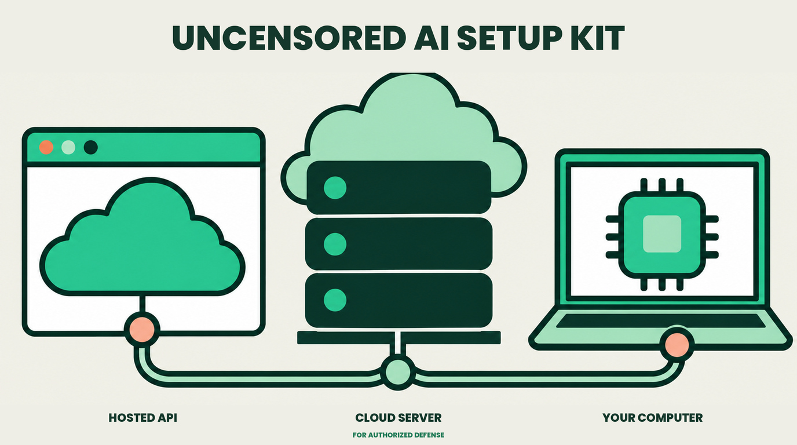

# Uncensored AI Setup Kit

Connect your own model to DeepSeek Harness, choose hosted API, RunPod, or local LM Studio, and verify that text, tools and screenshots work independently.

**Defensive use only. Work on systems you own or have explicit permission to test. Keep credentials private and verify AI findings before acting.**

**Start with [START-HERE.md](START-HERE.md)**, or give [ASSISTANT-SETUP.md](ASSISTANT-SETUP.md) to your assistant. Prefer a PDF? Open [the quick-start guide](downloads/quick-start.pdf).

## Inside

- Nine copyable setup prompts, with a separate record of the original video messages.
- Three route guides plus tool setup, model safety, cost control and troubleshooting.
- Credential-free configuration examples.
- A two-turn/function/image API checker and a synthetic localhost lab.
- An optional idle proxy with dry-run mode for an existing RunPod endpoint.

Read [verification/STATUS.md](verification/STATUS.md) for the tested versions and limits. A provider dropdown, tutorial or passing unit test does not prove every hosted account, operating system or GPU combination works. No model weights or paid services are included.

## Learn, then connect

Start on the local lab. Verify one capability at a time. Keep a known working setup as a fallback. Never point a scanner at a real application until ownership or written permission, exact scope and limits are established.

[Defensive-use policy](DEFENSIVE-USE.md) · [Report a problem](SECURITY.md) · [Official sources](LINKS.md) · [Third-party notices](THIRD-PARTY-NOTICES.md)

## Community

For more practical AI tutorials and walkthroughs, visit [Early AI-dopters](https://www.skool.com/earlyaidopters/about).

---

## Use and limitations

For education and authorized defensive use only. Test only systems you own or have explicit permission to test, within the agreed scope. Do not use these materials for unauthorized access, data theft, service disruption, or other unlawful activity.

These materials are provided “as is” and “as available,” without warranties to the extent permitted by applicable law. They are not legal advice, a professional security assessment, or a guarantee of security, accuracy, compatibility, availability, or fitness for a particular purpose. AI output can be incorrect or unsafe. Review commands, code, findings, and configuration changes before use.

You are responsible for permissions, backups, credentials, personal data, third-party terms, and usage charges. Third-party tools, models, availability, and pricing can change. Test in an isolated environment with synthetic data before considering production use.

To the extent permitted by applicable law, the creators and contributors disclaim liability for losses or damages arising from use of or reliance on these materials. Nothing in this notice excludes or limits liability, warranties, rights, or remedies that cannot lawfully be excluded or limited.
