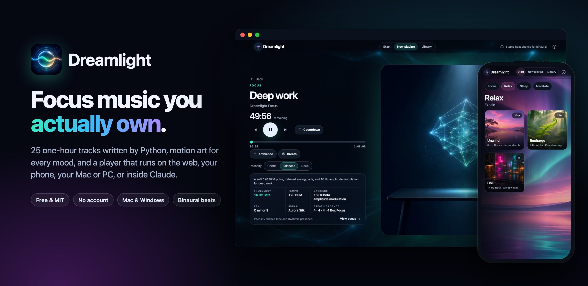
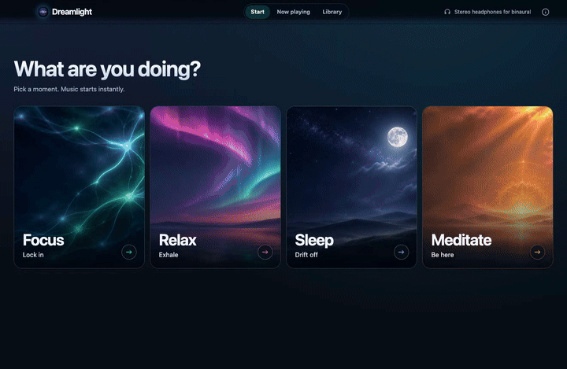
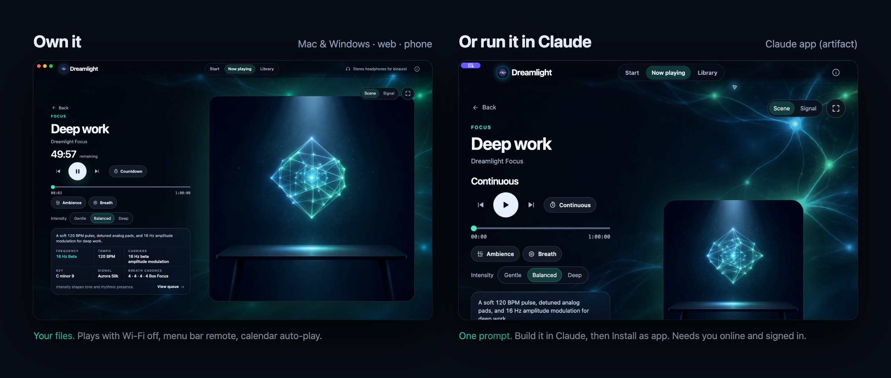
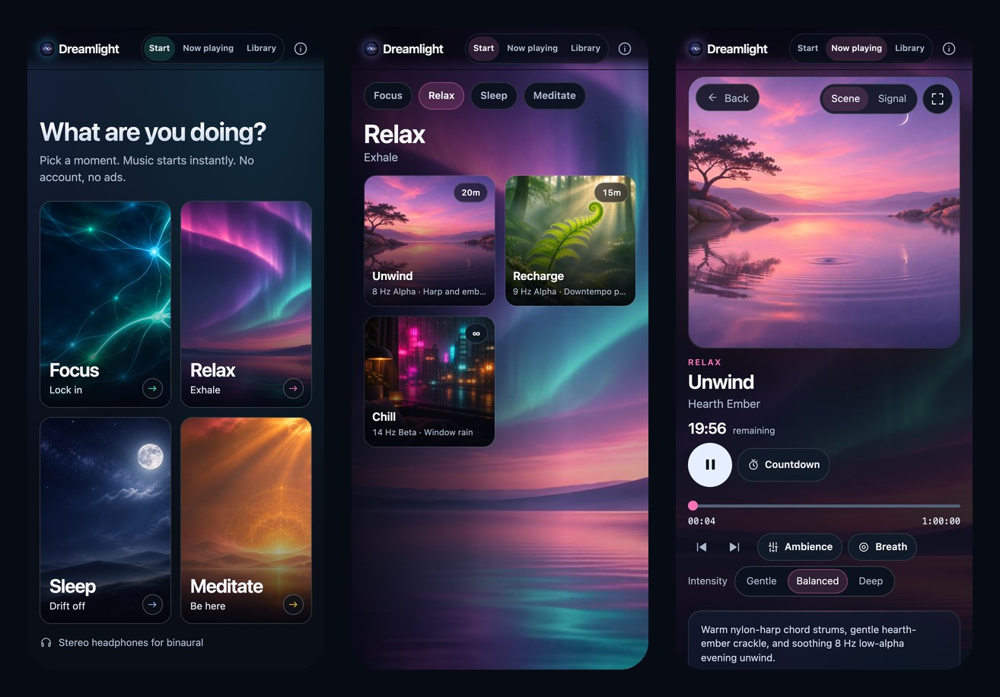
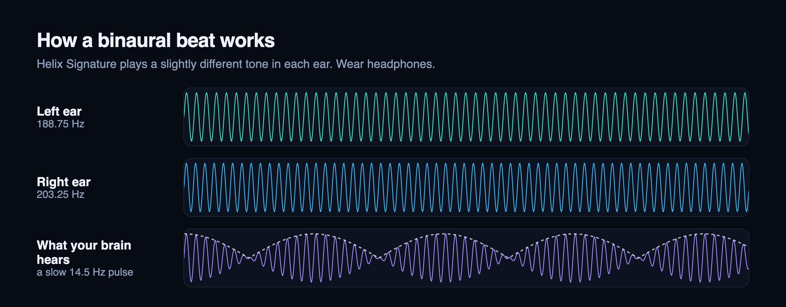

<p align="center">
  
</p>

<p align="center">
  <b>Free, open-source focus music.</b> Pick what you're doing and the music starts.<br>
  25 one-hour tracks made entirely with Python · motion art for every mood · web, phone, Mac, Windows and Claude.
</p>

<p align="center">
  <a href="#set-it-up-with-one-prompt">Set it up</a> ·
  <a href="#four-ways-to-run-it">Four ways to run it</a> ·
  <a href="#add-it-to-your-phones-home-screen">Phone</a> ·
  <a href="#how-the-music-is-made">How the music is made</a> ·
  <a href="#connect-your-calendar">Calendar</a> ·
  <a href="prompts/">Prompts</a>
</p>

---

## Set it up with one prompt

Copy this into **Claude Code**, **Codex**, or any AI agent that can run commands on your computer. It does the whole setup for you, explains each step in plain English and asks before installing anything.

```text
Set up Dreamlight for me, the free focus music app at
https://github.com/promptadvisers/dreamlight

I'm not technical, so please do every step yourself, explain each one in a sentence of
plain English, and ask me before you install anything on my computer.

1. Check that I have git and Python 3. If something is missing, tell me what it is and
   install it once I say yes. On Windows, Python may be called "python" instead of
   "python3".
2. Download the project into a folder called dreamlight in my home folder. If I already
   unzipped Dreamlight-App.zip, use that folder instead.
3. Get the music by running "python3 get_music.py" inside that folder. It's about
   2.2 GB, so tell me roughly how long that will take on my connection.
4. Start the player with "python3 server.py 8787", open http://localhost:8787 in my
   browser, and check that a track plays.
5. Then ask me which of these I want, and do the ones I pick.
   a) A desktop app that plays offline. Install Node.js if I don't have it. In the
      desktop folder run "npm install", then "npm run install:mac" on a Mac (Dreamlight
      goes in my Applications folder) or "npm run install:win" on Windows (Dreamlight
      goes in my Start menu and on my desktop). On Linux, run "npm start" instead.
   b) A website I can open on my phone. Deploy the web folder to Vercel, helping me sign
      in or make a free account. The music is 2.2 GB and Vercel's free plan may refuse
      an upload that big. If it does, deploy the player without web/audio, put the MP3s
      on storage that allows cross-origin requests (Cloudflare R2's free tier fits),
      point the "url" fields in web/tracks.json at them and redeploy. Then give me the
      link and walk me through adding it to my home screen.
   c) My Google Calendar, connected through Composio, so I can add focus sessions to my
      calendar and have music start after my meetings. This works in the desktop app, so
      set up a) first if I haven't. Follow the "Connect your calendar" section of the
      README. Never show my Composio key on screen or save it inside the project folder.
6. Finish with a short summary of what's installed, where it lives, and how to open it
   next time.
```

Prefer to do it by hand? Every step is below.

<p align="center">
  
</p>

## What's inside

- **25 one-hour tracks**, rendered by the Python in [`generators/`](generators/). No samples, no audio loops, no outside audio, so the music is royalty-free and yours to use.
- **14 activities** across Focus, Relax, Sleep and Meditate. Deep work, Morning coffee, Study with 25/5 intervals, Power nap with a gentle wake, Breathwork with a breath pacer, and more.
- **Motion art for every mood.** Each activity, mode and track has its own seamless video loop, plus a live "Signal" visualizer that reacts to the music.
- **Ambience on top.** Rain, ocean and vinyl crackle, synthesized live in your browser.
- **A real desktop app for Mac and Windows.** A remote in the menu bar or system tray, a countdown on the Dock or taskbar icon, a global play/pause shortcut, Open at login, and it plays with Wi‑Fi off.
- **Your calendar, optional.** In the desktop app, add a focus session to Google Calendar, or let Dreamlight start Deep work ten minutes after your meetings end.
- **No account, no ads, no tracking.** Plain files you can host anywhere, fork or change.

> Binaural beats need stereo headphones. Dreamlight is music for focus and relaxation, not a medical device.

## Four ways to run it

<p align="center">
  
</p>

| | Where it runs | Plays offline | Needs |
|---|---|---|---|
| **1. Web** | Any browser, from your computer | Yes, from your own computer | Python 3 |
| **2. Phone** | Home screen app (PWA) on iPhone or Android | No, it streams from your host | A hosted copy of `web/` |
| **3. Desktop app** | Its own app on Mac or Windows, plus a menu bar or tray remote | Yes | Node.js |
| **4. Claude app** | A window of Claude Desktop, via Install as app | No, it needs you online and signed in to Claude | A Claude account and one prompt |

### 1. Web

```bash
git clone https://github.com/promptadvisers/dreamlight && cd dreamlight
python3 get_music.py              # downloads the 25 tracks (2.2 GB) into web/audio
python3 server.py 8787            # then open http://localhost:8787
```

`get_music.py` only uses Python's standard library and skips tracks you already have, so you can stop it and run it again. Want a quick test first? `python3 get_music.py --only 3`.

Downloaded the ZIP instead of cloning? Unzip it, open a terminal in the `dreamlight` folder and start from `python3 get_music.py`. On Windows, use `python` in place of `python3`. On a Mac you can also double-click `start_player.command` once the music is in.

### 2. Phone

Host the `web/` folder on a static host. The Vercel CLI is the quickest route.

The music is 2.2 GB (about 82 MB a track), and free hosting plans often cap uploads well below that. Vercel's free plan, for example, limits CLI uploads to 100 MB. If your host refuses it, deploy the player without `web/audio`, put the MP3s on storage that allows cross-origin requests (Cloudflare R2's free tier fits, S3 works too), point the `url` fields in `web/tracks.json` at them, and deploy again.

```bash
npm i -g vercel
cd web && vercel --prod           # sign in when it asks, then open the link it prints
```

Then add it to your home screen, below. The phone version streams the music, so it needs an internet connection.

### 3. Desktop app (Mac and Windows)

Get the music first (step 1), then:

```bash
cd desktop
npm install
npm run install:mac               # Mac: puts Dreamlight.app in Applications
npm run install:win               # Windows: puts Dreamlight in the Start menu and on the desktop
npm start                         # or just run it from here, on any system including Linux
```

The desktop app serves `web/` from your disk, so it plays with no internet at all. Close the window and it keeps playing.

| | Mac | Windows |
|---|---|---|
| Where it installs | `/Applications/Dreamlight.app` | `%LOCALAPPDATA%\Programs\Dreamlight`, no admin rights needed |
| Remote | Click the menu bar icon, right-click for the full menu | Click the tray icon by the clock, right-click for the full menu |
| Session timer | Counts down in the menu bar and on the Dock icon | Fills the taskbar icon like a progress bar |
| Quick controls | Right-click the Dock icon | Right-click the taskbar icon |
| Play / pause anywhere | Cmd+Shift+Space | Ctrl+Shift+Space |
| Open at login | Right-click the menu bar icon | Right-click the tray icon |
| Remove it | Drag it from Applications to the Bin | `npm run uninstall:win` |

Want a copy to share without the setup? `npm run build:mac` or `npm run build:win` makes the app in the `dist` folder without installing it. Zip it and send it. The app isn't signed by Apple or Microsoft, so on first open a Mac may ask you to right-click and choose Open, and Windows may show "Windows protected your PC", where you choose More info, then Run anyway.

### 4. Claude app

Two options.

- **Build a light version with one prompt.** Paste [`prompts/BUILD-IT-IN-CLAUDE.md`](prompts/BUILD-IT-IN-CLAUDE.md) into a new Claude chat, then choose **Install as app** from the artifact's menu. Its music is generated live in the browser, so it needs no files.
- **Put the full app inside Claude.** [`claude-artifact/`](claude-artifact/) holds the Claude version of this exact player, with Claude's menu bar, shortcut and notification controls. `claude-artifact/build.sh` packages it and shrinks the tracks to fit Claude's 20 MB per-file limit. See [`claude-artifact/README.md`](claude-artifact/README.md).

## Add it to your phone's home screen

<p align="center">
  
</p>

Dreamlight is a progressive web app (PWA). That means it's a website you can save to your home screen, and it then opens full screen like any other app.

**iPhone or iPad (Safari)**

1. Open your Dreamlight link in **Safari**.
2. Tap the **Share** button (the square with an arrow pointing up).
3. Scroll down and tap **Add to Home Screen**.
4. Leave the name as Dreamlight and tap **Add**.
5. Open it from the new icon. It launches full screen, without the browser bar.

**Android (Chrome)**

1. Open your Dreamlight link in **Chrome**.
2. Tap the **⋮** menu in the top right.
3. Tap **Add to Home screen** (on some phones it's **Install app**).
4. Tap **Install** or **Add**.
5. Open it from the new icon.

Plug in headphones for the binaural tracks. On iPhone, the ring/silent switch can mute web audio, so check it if you hear nothing.

## How the music is made

<p align="center">
  
</p>

Every track is code that writes the sound wave by wave, one hour at a time.

1. **A different tone in each ear.** Nearly every track plays a slightly different pitch in the left and right ear. Your brain hears the gap between them as a slow, gentle pulse, which is called a binaural beat. Helix Signature, above, plays 188.75 Hz on the left and 203.25 Hz on the right, and you hear a 14.5 Hz pulse. Dreamlight Focus uses a 16 Hz volume pulse instead, so it works without headphones too.
2. **Music on top.** The engines in [`generators/engines.py`](generators/engines.py) layer soft chord pads (felt piano, harp, Rhodes, glass synths), a bass line, warm noise and gentle rhythm, and crossfade every chord change so the whole hour flows without a seam.
3. **Checked, not guessed.** `python3 -m generators verify` measures every file's length, loudness, true peak, silence gaps and left/right tone separation. The results are in [`reports/render-report.md`](reports/render-report.md).

Faster pulses suit focus and slower ones suit rest and sleep.

<details>
<summary><b>All 25 tracks</b></summary>

| Track | Beat | Sound |
|---|---|---|
| Cobalt Lattice | 42 Hz Gamma | Precision Analysis & Architecture |
| Neon Synapse | 40 Hz Gamma | FM Plucks for Coding |
| Prism Spark | 36 Hz Gamma | Glassy Synths for Creative Work |
| Kinetic Forge | 24 Hz High-Beta | High-Beta Rhythmic Drive |
| Aurora Ascent | 20 Hz High-Beta | Morning Launch & Energy |
| Solar Flare | 18 Hz High-Beta | Peak Momentum Sprint |
| Quartz Engine | 17 Hz Mid-Beta | Systems Thinking & Execution |
| Dreamlight Focus | 16 Hz Beta | Deep Work & Concentration |
| Obsidian Pulse | 15 Hz Mid-Beta | Deep Work Sprint |
| Helix Signature | 14.5 Hz Low-Beta | Custom Personalized Focus |
| Rainlit Loft | 14 Hz Low-Beta | Warm Lo-Fi Rain & Study |
| Cedar Study | 13.5 Hz Low-Beta | Quiet Reading & Research |
| Golden Atelier | 13 Hz SMR | Steady Reading & Calm Study |
| Amber Horizon | 12 Hz SMR | Calm Sustained Focus |
| Moss Courtyard | 11 Hz High-Alpha | Ideation & Open Thinking |
| Emerald Canopy | 10 Hz Alpha | Organic Handpan & Breeze |
| Velvet Drift | 9 Hz Alpha | Creative Flow & Writing |
| Hearth Ember | 8 Hz Low-Alpha | Evening Unwind & Decompress |
| Dusk Lagoon | 7.5 Hz Theta | Twilight Unwind & Daydream |
| Midnight Tide | 6 Hz Theta | Deep Reset & Meditation |
| Saffron Sanctuary | 5.5 Hz Theta | Breathwork & Deep Meditation |
| Cloud Drift | 4.5 Hz Theta | Power Nap & Hypnagogia |
| Abyssal Drift | 3 Hz Delta | Low Drones for Sleep |
| Lunar Cradle | 2.5 Hz Delta | Starlight Sleep & Calm Night |
| Deep Trench | 1.5 Hz Delta | Organ Drones for Sleep |

</details>

### Render the tracks yourself

Instead of downloading them, you can make every track on your own machine. You need Python 3, `ffmpeg` and about 2.2 GB of space.

```bash
pip install -r requirements.txt
python3 -m generators list                                    # all 25 tracks
python3 -m generators render --track dreamlight               # one track, one hour
python3 -m generators render --track saffron_sanctuary --duration 30 --output /tmp/preview.mp3
python3 -m generators verify --report reports/render-report.md
```

**Make Helix Signature your own.** Helix turns any three-column CSV (name, id, value) into its own melody and random seed. The repo ships a clearly fake example, [`generators/sample_dna_fake.csv`](generators/sample_dna_fake.csv), and the published track is rendered from it. Point it at your own file to get a version no one else has. Your CSV never leaves your computer, and nothing from it is saved except the finished audio and its cover.

```bash
python3 -m generators dna --csv generators/sample_dna_fake.csv --duration 30 --output /tmp/helix_test.mp3
```

## Connect your calendar

The desktop app can talk to Google Calendar through [Composio](https://composio.dev), with no Claude in the loop. Composio's free plan is plenty for this.

1. Make a free Composio account and copy your **User API key** (not the Project API key), **Org ID** and **Project ID** from its settings.
2. Save them in `~/.config/dreamlight/composio.json`, which is `%USERPROFILE%\.config\dreamlight\composio.json` on Windows. It sits outside this project, so it can never be committed.

   ```json
   {
     "userApiKey": "your-composio-user-api-key",
     "orgId": "your-composio-org-id",
     "projectId": "your-composio-project-id"
   }
   ```

   Or set `COMPOSIO_USER_API_KEY`, `COMPOSIO_ORG_ID` and `COMPOSIO_PROJECT_ID` instead.
3. Open Dreamlight, click the **ⓘ** button, and press **Connect** next to Google Calendar. Sign in with Google in the browser window that opens.

Then you get two things.

- **Add to calendar.** While a timed session plays, one click puts it on your calendar as a focus block.
- **Play after meetings.** Switch it on in the ⓘ panel or the menu bar. Ten minutes after a meeting ends (one with another guest or a video link), Dreamlight starts Deep work on its own. It skips the trigger if another meeting starts within 15 minutes, never interrupts music that's already playing, and remembers the day's meeting times, never their titles, so it still works if you go offline. It runs while the app is open, including from the menu bar, so turn on Open at login.

Your key is read only by the desktop app's main process and sent only to Composio. With no config file, Dreamlight never touches the network.

## Rebuild it with your own AI

Everything here was built with AI, and the prompts are in [`prompts/`](prompts/).

| Prompt | What it does |
|---|---|
| [`SET-IT-UP.md`](prompts/SET-IT-UP.md) | The one-prompt setup at the top of this page |
| [`BUILD-IT-IN-CLAUDE.md`](prompts/BUILD-IT-IN-CLAUDE.md) | Builds a self-contained Dreamlight as a Claude app |
| [`OWN-YOUR-CLAUDE-APP.md`](prompts/OWN-YOUR-CLAUDE-APP.md) | Turns any Claude app into a web app you own, with a database, hosting and Composio |
| [`desktop/PROMPT.md`](desktop/PROMPT.md) | Wraps the website into an offline Electron desktop app |

## Project layout

```text
dreamlight/
├── web/                 The player. Plain HTML, CSS and JavaScript, no build step
│   ├── tracks.json      The 25 tracks (generated from generators/catalog.py)
│   ├── covers/          Cover art and the seamless cover loops
│   ├── motion/          Mode and activity art and loops
│   └── audio/           The MP3s (downloaded or rendered, not in git)
├── desktop/             Mac and Windows app, menu bar and tray remote, Composio and play-after-meetings
├── claude-artifact/     The Claude app version and its build script
├── generators/          Python and NumPy music engines, covers and verification
├── prompts/             Prompts to set up, rebuild or reimagine it
├── get_music.py         Downloads the tracks from the GitHub release
├── server.py            Local server with fast seeking for one-hour files
└── reports/             Loudness and binaural measurements for every track
```

The MP3s are about 82 MB each, so they live in the [`audio-v1` release](https://github.com/promptadvisers/dreamlight/releases/tag/audio-v1) instead of git. That keeps the clone small.

## Credits

- **Music** made with Python and NumPy, by the code in this repo. No samples or third-party audio.
- **Art and motion** made with [Higgsfield](https://higgsfield.ai). Claude planned every scene and generated it through the Higgsfield connector, with GPT Image 2.6 for the stills and Kling 4.0 for the seamless loops.
- **Built with AI.** Claude (Anthropic) built and planned most of it, with design reviews and implementation from Gemini 4 Neon and GPT-6.2 Sol. Gemini 4 Neon built the Composio connection, and Claude built play-after-meetings.
- **Made by** [Prompt Advisers](https://www.promptadvisers.com/).

## License

[MIT](LICENSE). Use it, fork it, change it, ship your own version.
