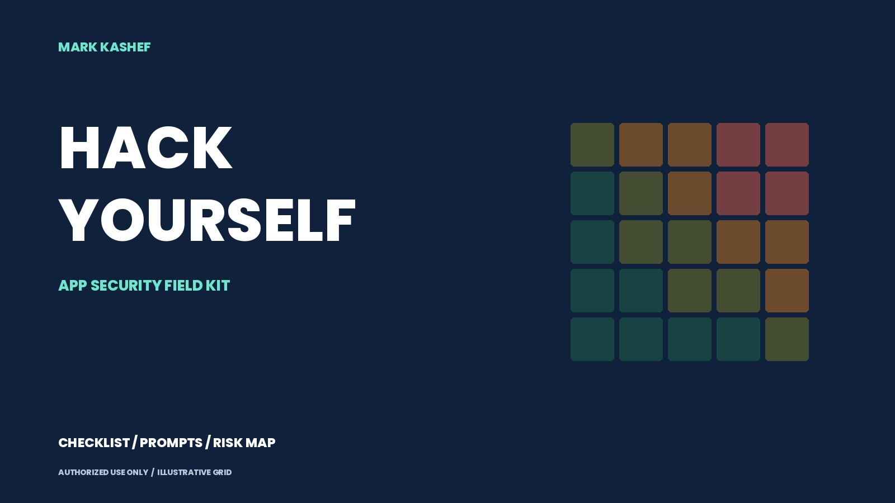
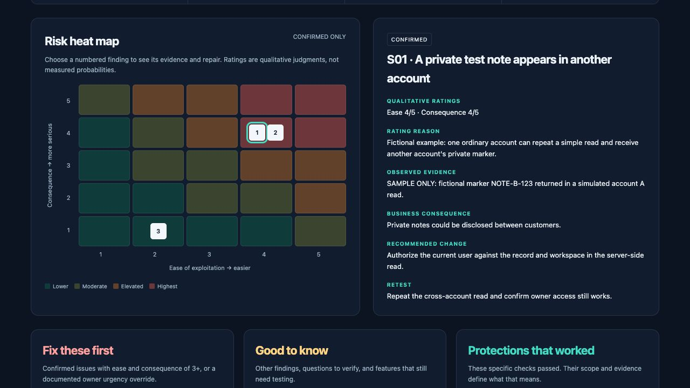

# Hack Yourself: App Security Field Kit

**Check whether one customer can reach another customer's private information, keep the evidence, and verify the fix.**

Built for people who make apps with AI. Start with one feature, then use the wider checklist to choose what to test next.

<p>
  <a href="https://github.com/earlyaidopters/hack-yourself-security-kit/releases/latest/download/APP-SECURITY-FIELD-KIT.zip"><strong>Download the complete kit</strong></a>
  &nbsp; · &nbsp;
  <a href="START-HERE.md">Start here</a>
  &nbsp; · &nbsp;
  <a href="ALL-PROMPTS.md">Copy the prompts</a>
  &nbsp; · &nbsp;
  <a href="CHECKLIST.md">Browse the checklist</a>
</p>



[](https://github.com/earlyaidopters/hack-yourself-security-kit/actions/workflows/check.yml)

> **Authorized defensive use only.** Test systems you own or have explicit written permission to test, using synthetic data and the agreed scope. A passed check is not security certification. [Use boundaries](DEFENSIVE-USE.md) · [Full limitations](DISCLAIMER.md)

## Start here

**You can read the guides and try the report without installing anything.**

1. **[Download the ZIP](https://github.com/earlyaidopters/hack-yourself-security-kit/releases/latest/download/APP-SECURITY-FIELD-KIT.zip) and extract it.** Everything is inside the `APP-SECURITY-FIELD-KIT` folder.
2. **Open [START-HERE.md](START-HERE.md).** Prepare a test copy of your app, two ordinary test accounts, and one fictional private record.
3. **Run one check with your assistant.** Use the [prepare-session prompt](prompts/00-prepare-session.txt), then the [first-check prompt](prompts/01-first-check.txt). Replace `YOUR_APP_URL` and `TEST_RECORD_URL`; provide test logins privately.

For example, put `PRIVATE-NOTE-B` in a fictional note belonging to account B. Confirm that B can read it, then have the assistant request it using account A's session. Inspect the returned evidence and intended sharing rule before deciding whether access was wrong.

Your assistant needs tools that can open the app or make web requests. A text-only chat can suggest tests but cannot run them. For model setup, use the companion [Uncensored AI Setup Kit](https://github.com/earlyaidopters/uncensored-ai-starter-kit). Other suitable assistants can follow this workflow too.

## See what happened and what to fix



*Actual report interface with fictional sample data. These are teaching examples, not findings about CollabDesk, a client, or your app.*

Confirmed findings appear on a clickable grid, with evidence and repairs beside them. Three lists separate urgent fixes, useful follow-ups, and checks that passed.

**Try it:** open `report/risk-report.html` from the extracted ZIP and click **Try fictional sample**. Or [download the report file directly](https://github.com/earlyaidopters/hack-yourself-security-kit/releases/latest/download/RISK-REPORT.html), then open that downloaded file in your browser. GitHub's HTML source view does not run it.

For your results, use the [report prompt](prompts/05-build-risk-report.txt) and [blank JSON template](templates/assessment.blank.json). Have your assistant prepare the JSON file, then review it for passwords, tokens, and private information before importing. The page makes no network requests and uses no persistent storage. **Export JSON before closing or reloading** to keep your work.

## Open the file you need

| You want to… | Open this |
| --- | --- |
| Read the workflow and complete checklist | [24-page field guide](downloads/APP-SECURITY-FIELD-GUIDE.pdf) |
| Understand the five examples from the video | [Five everyday-feature stories](guides/FIVE-FEATURE-STORIES.md) |
| Choose your next review item | [50-item checklist across seven areas](CHECKLIST.md) |
| Copy a prompt without hunting through folders | [All six prompts](ALL-PROMPTS.md) |
| Print a scope, evidence, or retest sheet | [Three-page worksheet pack](downloads/TEST-WORKSHEETS.pdf) |
| Record permission, coverage, and findings | [Editable templates and instructions](templates/README.md) |
| Verify a repair and normal owner access | [Fix-and-retest guide](guides/FIX-AND-RETEST.md) |
| Understand ratings or resolve a setup problem | [Risk ratings](guides/RISK-RATINGS.md) · [Troubleshooting](guides/SETUP.md) |

The five stories cover password resets, customer reviews, metered AI chat, checkout prices, and assistants that read email. Each connects the normal action to a possible failure, a controlled check, the evidence, and a repair.

<details>
<summary><strong>Which prompt comes next?</strong></summary>

| Prompt | Its job |
| --- | --- |
| [00 · Prepare the session](prompts/00-prepare-session.txt) | Confirm scope, tools, account sessions, and runtime limits |
| [01 · First check](prompts/01-first-check.txt) | Compare owner access with a second ordinary account |
| [02 · Go deeper](prompts/02-go-deeper.txt) | Review related routes within the agreed request budget |
| [03 · Review the evidence](prompts/03-review-evidence.txt) | Challenge weak proof and separate observations from guesses |
| [04 · Fix and retest](prompts/04-fix-and-retest.txt) | Review a repair, then repeat the forbidden and normal actions |
| [05 · Build the risk report](prompts/05-build-risk-report.txt) | Prepare redacted JSON for the offline heat map |

Keep the completed scope sheet beside the prompts. Configure tool permissions and limits in the software that runs your assistant; a prompt alone cannot enforce them.

</details>

## Know what the result means

| Result | What you can conclude |
| --- | --- |
| **Confirmed** | Evidence supports the specific issue and stated impact. |
| **Passed** | The exact action tested behaved as expected. |
| **Needs review** | A concern needs more evidence before it becomes a finding. |
| **Not tested** | No conclusion is available for that check. |

A successful HTTP status or confident AI answer is not enough on its own. Confirm the account session, record owner, and returned content. After a repair, repeat the original forbidden action and confirm the owner can still use the feature.

## What was verified

The kit has automated report checks, independent reconciliation of the checklist, browser import/export and mobile checks, and rendered review of every PDF page. A small synthetic exercise checked the evidence-review prompt; it is not a general model-performance result.

Read [verification/STATUS.md](verification/STATUS.md) for coverage and limits, and [SOURCES.md](SOURCES.md) for official implementation references. Opening the kit performs no scan, and no real app findings are bundled.

<details>
<summary><strong>For developers: verify or rebuild</strong></summary>

Finished assets are included. Rebuilding is optional.

```sh
node tests/report.test.cjs
python3 scripts/verify_resource.py
```

To regenerate the PDFs, covers, and self-contained report:

```sh
python3 -m pip install -r requirements-build.txt
python3 scripts/build_assets.py
```

[SHA256SUMS](SHA256SUMS) identifies the finished guides, report, combined prompts, and checklist. No model weights, API credits, or paid services are included.

</details>

## Downloads and support

[Latest release](https://github.com/earlyaidopters/hack-yourself-security-kit/releases/latest) · [Gumroad download](https://markkashef.gumroad.com/l/hack-yourself-checklist) · [Changelog](CHANGELOG.md)

The Gumroad minimum is zero. Optional contributions receive the same files. Documentation update: **1.0.1, 30 October 2026**. The previously reviewed PDFs and report remain at asset version 1.0.0.

For a kit problem, follow [SECURITY.md](SECURITY.md). Keep private findings, credentials, and customer information out of public issues. For more practical AI walkthroughs, visit [Early AI-dopters](https://www.skool.com/earlyaidopters/about).

[Full disclaimer](DISCLAIMER.md) · [Defensive use](DEFENSIVE-USE.md) · [Third-party notices](THIRD-PARTY-NOTICES.md) · [MIT license](LICENSE)
