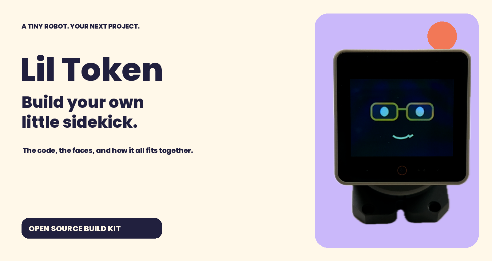
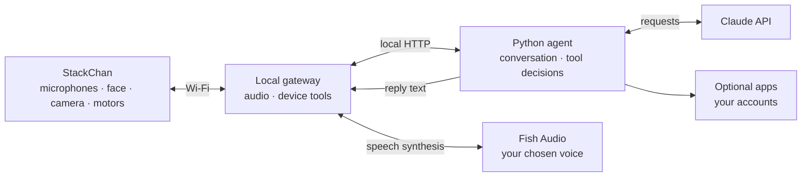

<p align="center"></p>

# Meet Lil Token

A little desk robot that talks back, looks around, reacts to a head pat, and puts on a different hat when the music changes.

This is the public build kit from Mark Kashef’s robot video. It includes the agent, the gateway changes, the firmware source, editable faces, and the lessons from getting them to work together. You can build the whole robot or borrow one part for your own project.

**[Start building](docs/QUICKSTART.md) · [See the architecture](docs/ARCHITECTURE.md) · [Meet the faces](docs/FACES.md) · [Read the build story](docs/BUILD-GUIDE.md) · [Fix a problem](docs/TROUBLESHOOTING.md)**

## Pick your first experiment

| I want to… | Start here |
| --- | --- |
| Explore the code before buying hardware | `python3 examples/desk_demo.py` runs a small offline request through a pretend robot |
| Change his expression | Open the PNGs in `assets/faces/`, then try the face generators |
| Build the talking robot | Follow the [quick start](docs/QUICKSTART.md) with a StackChan and a Mac |
| Understand how an agent controls a physical object | Follow one question through the [architecture](docs/ARCHITECTURE.md) |
| Give my AI agent the project | Start with [the research prompt](prompts/01-research-and-backup.md) |

## A robot, a gateway, an agent

The robot supplies the microphones, speaker, camera, motors and screen. A gateway on your computer carries audio and device commands. The agent decides when to answer, look, search or use a configured app. Fish Audio turns its words into speech.



The first things to try are “Hey Lil Token, what can you do?”, a head pat, and asking him to look at an object you hold up. Search becomes available when you add a Firecrawl key. Email, business tools, Composio, presence checks and voice-triggered code jobs each have their own setup.

## What you get

- `brain/` contains the conversation loop, agent tools, memory, reminders, reactions, music classification and optional account adapters.
- `fork/files/` contains the readable firmware and gateway modifications. `fork/lil-token.patch` rebuilds them on a pinned upstream commit.
- `avatar/` contains the Python face generators, binary face sets, hats and app badges.
- `assets/faces/` contains the editable expression PNGs. The [face guide](docs/FACES.md) explains their order and format.
- `prompts/` contains three copy-ready build prompts. They guide research, implementation and testing on your own hardware.
- `tests/` contains the regression suites and public-release checks.
- `docs/` explains setup, architecture, data flow, the build process and troubleshooting.

## Start small

```bash
git clone https://github.com/promptadvisers/lil-token-robot.git
cd lil-token-robot
python3 examples/desk_demo.py
```

The offline example uses the standard library and synthetic calendar data. For a physical robot, continue with the [quick start](docs/QUICKSTART.md). Start-up commands load this checkout’s `.env`, and new account integrations default to off.

The public setup uses your own Claude API credentials and Fish voice. The source keeps the recorded build’s `drama-3` speech model setting editable through `STACKCHAN_FISH_MODEL`. Check which model your Fish account supports before your first paid call.

## Build history and credits

This project grew through repeated Claude Code sessions, firmware builds and tests with the physical robot. The public edition adapts that working source with portable paths, new local configuration and conservative account defaults. The build guide explains those changes so you can follow them in the code.

The firmware and gateway build on [kisaragi-mochi/stackchan-mcp](https://github.com/kisaragi-mochi/stackchan-mcp), which builds on xiaozhi-esp32. Fish Audio supplies speech. Firecrawl supplies optional search. Composio supplies optional app connections. The robot is an M5Stack StackChan.

Original project code and documentation use MIT. Upstream notices are in `LICENSES/`; the servo library used by the combined firmware is GPL-3.0. App logos remain their owners’ trademarks. See [third-party notices](THIRD_PARTY.md).

Fish Audio sponsored the video that accompanies this project.
