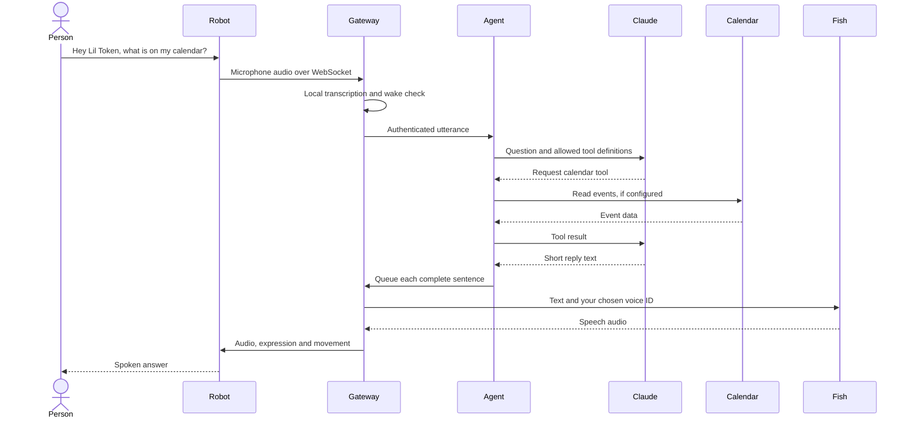

# Follow one question through the robot

Say “What is on my calendar?” The robot’s microphone produces audio. Local speech recognition turns it into text. The agent selects the calendar tool, receives the result and writes a short answer. Fish Audio generates the speech, and the gateway streams it to the robot’s speaker.

## The physical layer

The ESP32 firmware manages the screen, camera, touch, proximity, motion sensors, servos and audio. Commands pass through the gateway’s device-tool interface. The firmware remains responsive while the computer is thinking.

The changed files are under `fork/files/firmware/`. `stackchan.cc` handles the device-specific behavior. `avatar_set.cc` manages face sets. `audio_service.cc` handles audio. The partition CSV describes how the firmware uses the device’s flash.

## The gateway layer

`fork/files/gateway/stackchan_mcp/ears.py` owns continuous listening and wake matching. `speaker.py` owns the speech queue and interruption. `tts/fish_audio.py` turns reply text into speech. `capture_server.py` receives images and serves face assets to the device.

| Port | Purpose | Default reach |
| --- | --- | --- |
| 8765 | Robot WebSocket | Local computer until you set the LAN address |
| 8766 | Camera upload and face transfer | Same selected device interface |
| 8767 | Agent-to-gateway MCP | Loopback |
| 8771 | Wake, utterance and event hooks | Loopback |

Use a private network and the generated device token. Public port forwarding adds exposure this kit is not designed to handle.

## The agent layer

- `brain.py` owns the conversation lifecycle, interruptions and follow-up windows.
- `agent.py` keeps the Claude session and implements the tools it can request.
- `speech.py` detects complete sentences so speaking can begin before the full reply arrives.
- `skills.py` stores local memory and reminders.
- `senses.py` maps a sensor event to an expression and a short reaction.
- `music.py` classifies sound and selects a wardrobe and motion style.
- `connections.py` sets up an optional Composio session with restricted operations.

The tool definitions and their code determine what can run. The prompt provides behavioral guidance. Email, web results and other outside text are treated as data.

## Where information goes

| Information | Destination |
| --- | --- |
| Idle microphone audio | Local gateway and local speech recognition |
| An active conversation’s text and selected tool results | Your configured Claude service |
| Words to speak and the chosen voice ID | Fish Audio |
| A photo requested for visual understanding | Your configured Claude service |
| Search query | Firecrawl, when configured |
| Account request | The provider you explicitly connected |
| Memory, reminders and enrolled voice profile | Your local checkout |

Continuous transcription still processes nearby speech locally. Turn the processes off when you do not want the robot listening. Optional presence images are processed locally. A requested camera answer sends an image to the model.

## Public-edition changes

The device and conversation source comes from the working project. This edition adds portable launchers, explicit API-key setup, read-only Google and business adapters, account features disabled by default, and a fresh local token. Personal voice samples, stored memories, private account state, firmware backups and the old Git history are excluded.

The offline example uses a small deterministic tool choice to teach the request flow. The physical agent uses Claude’s tool calls in `brain/agent.py`.
