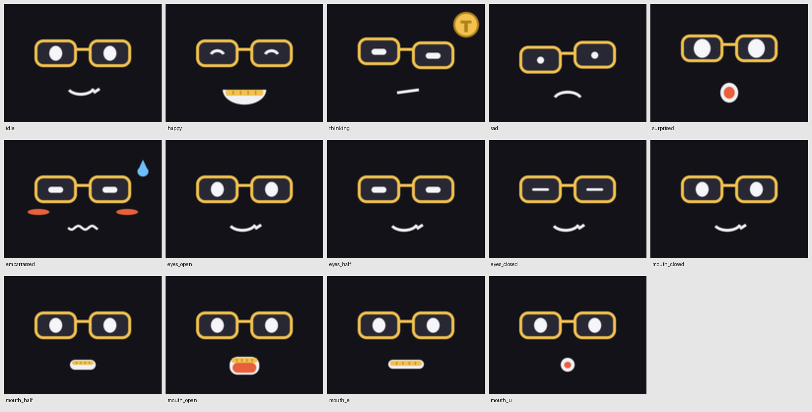

# Give him a face



The face is a set of small images. The firmware swaps those images for expressions, blinking and talking. Hats and badges can sit over the current expression.

## Open the PNGs

`assets/faces/` contains individual 320×240 PNGs you can edit in your image editor. Keep the names when rebuilding. The expression set has six faces, three eye states and five mouth shapes.

| Order | Files |
| --- | --- |
| Expressions | `idle`, `happy`, `thinking`, `sad`, `surprised`, `embarrassed` |
| Eyes | `eyes_open`, `eyes_half`, `eyes_closed` |
| Mouth | `mouth_closed`, `mouth_half`, `mouth_open`, `mouth_e`, `mouth_u` |

## Generate your own set

```bash
.venv/bin/python avatar/make_face.py
.venv/bin/python avatar/make_party.py
.venv/bin/python avatar/make_wardrobe.py
```

The first command draws editable frames into `avatar/frames/`. The next commands build the base and wardrobe binary sets from those frames. `make_research.py` adds official app badges and requires `rsvg-convert` (`brew install librsvg` on macOS).

`avatar/default.rgb565` is the normal face. `party.rgb565` is the tarboush. Other sets include classical, jazz, rock, hip-hop, electronic and ambient. `avatar/overlays/` contains the smaller hats and badges used by the overlay firmware.

A layered face file contains 14 images at 160×120, two bytes per pixel in RGB565 little-endian order. Its size is 537,600 bytes. An overlay contains a 160×120 RGB565 image plus an 8-bit alpha plane, totaling 57,600 bytes. The firmware scales the images onto the screen.

## Map a reaction

Open `brain/senses.py`. Each `REACTIONS` entry maps a sensor event to a face and several possible spoken lines. For example, a pickup event selects `surprised` and one of the pickup reactions. The short bracketed performance cue is passed to Fish Audio.

Try changing one reaction before redesigning the whole character. Keep eyes and mouth inside the screen, check every expression at the device’s small size, then test blinking and speech.

## Test on the robot

With the gateway running and the project configured:

```bash
.venv/bin/python tok.py set_avatar '{"face":"happy"}'
.venv/bin/python tok.py set_avatar '{"face":"thinking"}'
.venv/bin/python snap.py face-check.png
```

Rebuilding a PNG does not automatically flash firmware or upload a new runtime set. Use the gateway’s `load_avatar_set` tool for runtime sets, or rebuild the firmware for compiled-in defaults. The available tool schema comes from your pinned gateway.

App badges use their owners’ existing artwork. Keep them associated with the app they identify.
